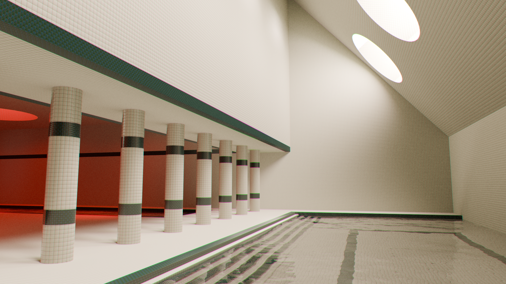

# Poolrooms Textures

A set of textures for the classic Poolrooms environment. Free to use for any purpose.

Above is an image of the textures rendered using Blender Cycles, postprocessed with G'MIC.

I also have a set of Backrooms textures, available [here](https://github.com/amini-allight/backrooms-textures).

## License

Textures created from scratch by Amini Allight. The contents of this repository are licensed under Creative Commons Zero (CC0 1.0), placing them in the public domain.
